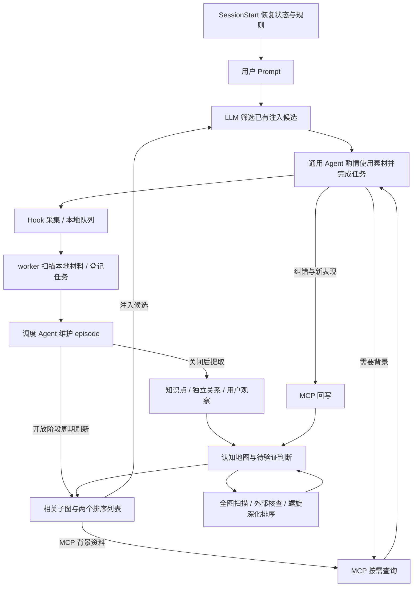

# DistillAI：初版需求与方向 Discussion

## 批准与当前阶段

2026-10-14，用户将 OS 写隔离移出当前初版，后续独立 Issue 再实现。当前使用普通独立 Hermes 子进程，保留任务副本、业务路径授权、模型计数、停树、冲突安全写回和恢复；不承诺拒绝自由命令的目录外写入。MXC / token / 沙箱 stdio 的验证和批准请求结束，具体范围以统一 Design 修订 1 和 M01 Plan 为准；后续 Issue 尚未创建。

2026-10-13，用户要求“现在开始按照plan执行”，批准当前统一 Design / Prompt、总 Plan 和八份模块 Plan 进入本地实施。当前执行 M01 Task 1；未验证运行能力和未选服务继续由 G1–G3 管理，远端操作授权保持独立。

2026-10-08，用户确认 Discussion 内容没有问题，授权整理后将状态改为 `approved`，进入实际设计讨论，并要求按模块分别保存 Design 和 Plan、分别实施。本文件作为初版需求、范围与方向基线。

已确认功能范围、四项验收、统一配置和本地 Web；2026-10-10 删除遗忘曲线，理解改为按历史回复估计，Web 只承担配置、查看与编辑。用户要求合并八模块 Design，冲突以 Design 为主。2026-10-12，用户最终选择 Hermes SDK / Python Library 的 `AIAgent` API 作为后台 Agent 执行入口，考虑后续 trajectory 蒸馏与小模型 RLVR；同日 grill 第一轮确认 Python 控制层 / Hook / MCP、独立任务执行子进程及三项业务交接补充。环境是否拆分留待依赖兼容验证，配套技术和训练细节待收敛。沙箱只限制写入，读取不限制；模型 API key 由用户填写，搜索方法延后确认。既有业务批准继续有效，其余新增交接及九组 / 十二段 Prompt 首稿见 [统一 Design](design.md)。2026-10-13 按用户要求创建[总 Plan](plan.md)和八份模块草案，批准状态不变，尚无产品实施。

当前契约先读 [统一 Design](design.md)，本文件保留需求与方向的 D / T / Q 编号；原模块 Design 为来源快照。

| 文档 | 职责与状态 |
| --- | --- |
| 本 Discussion | 已批准需求、方向与约束；保留稳定 D / T / Q 编号 |
| [统一 Design 与模块 Plan 路线](README.md#module-roadmap) | 八模块既有业务批准保留；Hermes Python Library / Python 和九项 grill 决定已确认。2026-10-13 总 Plan / 模块草案已创建，新增 Design / Prompt 与各模块 Plan 实施前仍需对应批准 |
| [C01 全流程案例](references/c01-flow.md) | 原始会话与设计分支对照；旧编号和原文不改写 |
| [R01–R06 调研依据](references/research.md) | 来源事实、历史候选与否决理由，供 Design 定向读取 |

## 项目骨架与已有结论

### 目标与角色

一个 Agent 对应一个用户。DistillAI 从用户与通用 Agent 的日常交互中积累有来源的知识，逐步判断用户如何解释、连接和应用这些知识。关键词与话题提供分析入口，用户的理由、条件、反例和实际应用提供理解证据。术语以 [领域词汇表](../../../CONTEXT.md) 为准。

本版本只考虑 Codex 接入。讨论中的“前端”对应 Codex 接入端，“后端”对应后台 Agent；后台持续维护同一用户的知识与用户模型。其他 AI 工具属于后续范围；已确认的本地 Web 由常驻后台提供，承担配置、历史浏览与模块行为核查，具体交互与接口见 T02。

| 部分 | 输入 | 职责与输出 |
| --- | --- | --- |
| Codex 接入端 | 会话与工具事件、当前任务、新增用户表现 | 采集增量材料，提供 Skill / MCP 入口，交付相关上下文并回写证据 |
| 后台材料整理 | 新增原始材料与来源 | 按交流连续性维护 episode，关闭后进入分析；边界与收尾见 [D02](design.md#episode-model) |
| 后台知识维护 | 会话知识候选、已有知识及来源 | 归一与综合 knowledge，维护概念、机制、条件及关系 |
| 后台用户模型维护 | 观察、知识关联与验证证据 | 生成和修订竞争假设，汇总关联知识点的理解状态 |
| 关联与检索 | 当前任务、知识点、关系、理解状态与假设 | 用图索引查询关联，选择相关知识、证据和未决假设；具体库后续选型 |
| MCP 交互 | 通用 Agent 的查询与回写请求 | 查询后台资料；记录纠错和验证表现，交给后台综合更新 |

这是职责分工，不预设每行都建立一个服务或执行一次模型调用。后台已确定本地常驻，控制层与 Hermes 任务执行进程分离；分析依赖按统一 Design 的 M03 → M04 → M05 交接执行，知识空结果不跳过用户表现分析。

### 完整流程与相邻交接

子图准备可发生在 episode 开放期间；从本次 episode 提取知识仍在关闭后。后续交流使用已保存知识，不能提前使用尚未提取的结果。

| 环节 | 交给下一环节的结果 |
| --- | --- |
| 采集 → 登记 | JSONL 队列及来源行号；cursor 表达已采集的筛选后消息数 |
| 登记 → 调度 | 共享队列固定来源范围、任务与处理位置；提交完成后推进处理位置 |
| episode → 分析 | 固定版本及来源；关闭 / 修订后登记 M04，成功后 M05 仍取得原 episode，知识空结果不跳过用户表现分析 |
| 提取 → 地图 | Agent 保存知识点、独立关系及用户观察文件；程序校验后刷新名称图 |
| 地图 → 扩展 | 有来源的知识联系与扩展发现，及用户是否了解候选、是否建立相关联系的待验证判断；随后整理知识点、关系与排序 |
| 开放 episode → 列表 | 周期子图与分别排序的 MCP 上下文列表、注入队列 |
| 用户 Prompt → 交付 | LLM 返回适用候选或空结果；程序校验后交付 |
| 回答 → 反馈 | 实际采用、用户自然表现与帮助条件；修订关于外扩知识及其联系的认知判断，供后续检索和引导参考 |

### 已确认决定

| 状态 | 内容 | 主题 |
| --- | --- | --- |
| confirmed | 依据调研推进初版开发，使用 Exploratory 流程；本版只接入 Codex | T01 / D01 |
| confirmed | 沿 Honcho 路线增量采集；过滤、来源与恢复以已批准 M02 为准，Desktop 实际触发待验证 | D01 |
| confirmed | 本地队列及采集 cursor，worker 直接读共享队列；M02 已替代发送进度、上传锁与接收确认，不使用 `.sent` / 上传 `.lock` | D01 |
| confirmed | `~/.distillAI` 统一管理运行数据，采集材料按 AI 工具分目录；初版采用文件持久化，暂不引入 PostgreSQL | D01 / T02 |
| confirmed | 原始材料、观察、知识与理解假设分层关联，采用 JSON/JSONL 表达 | D03 / T02 |
| confirmed | episode 保存某次完整交流；活跃记录、缓冲切分、收尾、LLM 评分及后台 Agent 调度与上下文成本控制已收敛，具体指标和运行参数留待下一层 | [D02](design.md#episode-model) |
| confirmed | 会话知识提取只整理材料实际内容，结合已有条目归一和综合；具体 Prompt 再推敲 | D03 |
| confirmed | 外扩提出知识联系及用户认知的待验证判断，注入后的自然交互提供验证与帮助机会，反馈用于修订认知地图；具体模型与更新规则待设计 | D04 / D05 / D06 |
| confirmed | 图用于关联查询，可从详情重建；具体库和图类型后续选型 | T03 |
| confirmed | 每条关系单独保存为一个文件；图中只保存节点和关系的名称，详情读取对应文件 | D03 |
| confirmed | 后台主动扫描整个认知地图，优先搜索连接多个已有知识点的候选，结合 OpenMAIC Skill 设计扩充流程 | D04 |
| confirmed | 后台 Agent 采用独立本地常驻程序 | T02 |
| confirmed | `~/.distillAI/config.json` 统一管理运行参数；本地 Web 提供配置、历史浏览和模块行为核查，保留当时的输入输出、配置与 Prompt 版本供回查 | T01 / T02 / T03 |
| confirmed | 后端通过 API 调用 LLM；先用现有供应商，后续私有模型单独通过 vLLM 部署为 LLM 服务 | T02 |
| confirmed | Hermes SDK / Python Library 执行层；后续利用 trajectory 蒸馏闭源模型能力并开展小模型 RLVR。环境组织与训练方案待设计；worker、任务副本与提交恢复沿 M01 | T02 / Q04 / Design T05 |
| confirmed | OS 写隔离延至后续独立 Issue；本次保留普通执行进程、任务副本、停树和程序提交，不承诺 OS 越界写拒绝 | M01 / Q04 |
| confirmed | 周期子图更新维护两个排序列表；用户 Prompt 到达后由 LLM 筛选注入，等待时间暂不设置；MCP 按需补充背景 | D05 |
| confirmed | 素材通过日常解释、类比和例子酌情引入，助手可跳过；费曼与最近发展区方法指导帮助调整及自然反馈 | D05 / D06 |
| confirmed | 根据用户历史回复及实际表现大致估计理解；删除遗忘曲线与相关预测要求 | M05 / Q10 |
| superseded | Q03 原遗忘预测与参数按需计算方案，已由历史回复形成的理解估计替代 | Q03 / Q10 |
| confirmed | 本阶段暂不采用 BKT、FSRS；后续按可评分表现、回忆数据和产品范围重新评估 | T03 |

### 判断与数据边界

原始材料、派生知识、用户证据、理解假设与理解判断保留各自来源和状态。提问、关键词频率、阅读、高亮、助手解释、AI 产物或提示后复述不能直接证明独立掌握。用户的解释和应用需连同条件、提示、是否看过答案及后续独立表现保存；一次成功不能证明稳定掌握或长期保持。

未知不等于不懂，未提及不等于知识盲区，时间经过不自动降低理解状态。知识、理解判断与实际回忆表现可以关联，但各自需要对应依据。模型自评置信度、格式正确和引用可定位，也不能单独证明结论正确。

检索记忆与模型推断是参考数据；行为规则由 Skill 等应用规则定义，不能把检索内容当成覆盖仓库规则的指令。相关依据见 [Zep 记忆安全文档](https://help.getzep.com/v3/memory-security)。

### 当前实现与设计方向的差距

当前代码只实现 `UserPromptSubmit` / `Stop` 原始 Hook 事件采集，按 `session_id` 追加到 `.distallAI/data/sessions/<session_id>.jsonl`；`DISTILLAI_HOME` 可改变数据根目录。它记录提问、最近助手回复与原始 payload，不能代表完整模型上下文、完整历史或全部工具过程。详见 [项目 README](../../../../README.md) 与 [Hook 配置](../../../../plugins/distill-capture/hooks/hooks.json)。

已有文档另记录 ZCode 配置 Hook，其 payload 没有 `turn_id`，配对需区分 AI 工具；该既有验证记录不扩大本版本的 Codex 接入范围。

Honcho 参考路线、后台整理、假设更新、图检索、Skill / MCP 上下文交付和回写均尚未实施。本地采集可行性证据不替代最终闭环的 Desktop 实测。调研范围及轮次见 [调研综述](../../../research/README.md)。

## 功能决定：D01–D06

各主题的状态为 `confirmed`；详细输入、例子和待定契约进入相应 Design。

### D01：数据采集与材料交付

按已批准 M02：Stop / PreCompact / SessionEnd 增量采集 rollout 用户与助手文本，PostToolUse 保存工具活动摘要。仅保留本地 JSONL 队列与 cursor；worker 直接读取队列登记任务，通知只唤醒，不上传正文。没有 `.sent`、上传锁或接收确认。采集位置与后台处理位置分别表达，任务提交完成后才推进处理位置。具体过滤和写入恢复已在 Design 明确。

产品数据根为 `~/.distillAI`，支持 `DISTILLAI_HOME`，材料按 AI 工具分目录，本版只接入 Codex。队列只包含 `{role,text,at?}`；派生来源为 connector / session_key / 1-based inclusive 行号，不增加源消息或轮次 ID。契约见 [M02](design.md#data-capture)，研究依据见 [R01](references/research.md#capture-reference)。

### D02：episode 构建、边界与维护

episode 保存一次连续交流的完整历史及来源，初版在 session 内切分；同主题的不同交流不自动合并，跨 session 通过关联表达续接。每个 session 最多一个活跃 episode，疑似切换材料先持久化并暂缓归属；连续三轮为初始观察窗口，不是三次投票或三次模型调用。

LLM 根据交流连续性给出评分、来源和边界建议，Agent 维护 episode 文件，程序校验规则符合程度和任务结果。切换、SessionEnd 或空闲可触发关闭；SessionEnd 实际支持仍待 Desktop 验证。关闭后生成 summary 并进入提取，关闭与分析完成分别表达；未满缓冲窗口也需收尾，边界允许后续纠错。

机制细节及边界候选见 [M03](design.md)，Agent 激活、材料合并、上下文成本及调度见 [M01](design.md#episode-scheduling)，历史修正见 [R02](references/research.md#episode-history)。

### D03：知识点、关系与认知地图

关闭的 episode 提取会话实际讨论的知识，结合已有条目归一和综合，不自行补充未讨论内容；原始材料、知识、用户观察、竞争假设与状态分层关联。知识点和每条关系各自保存详情；图只保存节点、关系名称及连接，可从权威记录重建，具体图处理库后续选型。

2026-10-09，用户接受 [M04 初版最小维护方案](design.md#minimal-knowledge-maintenance)：Agent 在 M01 任务副本中维护独立 JSON 详情，来源引用复用 M02，关闭 / 修订交接复用 M03；程序做必要业务校验，提交后全量重建名称映射与图。记录组织随后按现有 example 确认；用户进一步授权 Agent 确定其他剩余事项，已补齐[执行契约](design.md#knowledge-contracts)中的关系方向、业务输入输出、精确名称匹配、一跳查询、必要校验及维护案例。Graphify 图构建思想作为后续参考，具体库和正式 Prompt 后置。2026-10-10，用户批准 M04 当前 Design；跨模块对齐继续随对应 Design 收敛，知识空结果与 M05 用户表现分析的交接在 M05 设计时继续确认，尚无 Plan 或实施。

认知地图持续表征用户如何理解、连接和应用知识。知识联系是否成立与用户是否表达、理解或应用该联系分别判断；一次联想不自动证明稳定思考习惯。知识与图契约见 [M04](design.md)，历史回复形成的理解估计、假设与反馈见 [M05](design.md)。记录按知识点与关系 example 的字段分组组织，独立关系引用和队列来源已同步进合成示例；M04 业务交接与必要校验已补齐，认知具体语义仍归 M05，不另建模板。

### D04：外部搜索与知识扩充

后台主动扫描整个认知地图，优先寻找能连接多个已有知识点的候选。例如 a、b 已知，e 同时连接 a、b 时，在条件相近时优先于仅扩展单一节点的 c、d；当前必需先备知识可以优先。

参考 deep-research 搜索与核查、spiral-curriculum 深化与排序、UbD 明确理解目标和证据。优先级依据连接价值、理解增量与当前需要；外部资料是知识来源，不证明用户掌握。扫描、覆盖、重复探索、预算及停止条件见 [M06](design.md)。

### D05：检索、Prompt 注入与 MCP

开放 episode 首次成功保存后准备相关子图，之后按包含新材料的成功更新次数周期刷新，维护分别排序的 MCP 上下文列表和注入候选队列。收到当前用户问题后，由 LLM 筛选已有候选，程序校验后交付，每轮最多三条简短素材；未准备好或没有适用内容时返回空，不在本轮注入路径临时展开全图检索。MCP 资料不足时可按需扩大到完整地图。子图刷新三次更新只是示例，筛选暂不增加产品层等待时间限制，平台或供应商超时后按失败处理，本轮继续正常回答。

SessionStart 恢复已保存的会话关联、episode、子图与列表，交付简短规则和 Skill 入口，不凭启动事件新建 episode 或重新筛选。保留交付历史，普通轮次默认不连续重复同一建议；compact 后须重新注入本轮已选素材，沿用已保存的选择，不重新筛选，也不因已交付而跳过。MCP 提供按需查询与证据回写；与采集流的同源证据关联去重。2026-10-10，用户确认上述 [M07 初版上下文行为](design.md#context-decisions)，随后明确批准当前版本，M07 为 approved；必要接入字段按已有契约补齐，具体交付机制与正式 Prompt 后续确认，实际效果按 Q16 验证。

### D06：日常交互与反馈

围绕原任务自然使用解释、类比和例子，通用 Agent 可跳过素材。优先利用用户已有表现，只有有助于当前任务时才追问。参考费曼、最近发展区和螺旋操作符调整帮助、观察对应点、边界和迁移，不机械安排教学循环。

交付、助手可观察采用、用户接触、用户认可与独立应用分别记录。追问和沉默保留多种解释，获得帮助后的表现不反推帮助前的理解。反馈由后台支持、修订或保留竞争假设；具体记录见 [M05](design.md)，交互素材与回写接口见 [M07](design.md)。

## 范围与技术边界：T01–T04

### T01：初版目标与交付范围

状态：`confirmed`。当前功能范围与验收方向已确认，包含 2026-10-10 用户明确删除遗忘曲线与相关预测要求的范围调整；具体行为、接口与验收步骤在后续阶段细化。

#### 已确认范围与历史候选

2026-10-04 已确认：根据当前调研结果完成初版项目开发，按 Exploratory 流程推进。

2026-10-08，用户明确“所有讨论的功能全做”。初版采用完整功能范围：D01–D06 的采集与交付、episode 维护、知识点与关系及认知地图、主动外部扩展、子图与两个列表、LLM 筛选注入、MCP 查询与回写、日常引导及自然反馈全部纳入；当时候选 C 包含知识浏览、编辑与复习。2026-10-10 用户明确删除遗忘曲线与相关预测要求，理解判断改为根据历史回复大致估计；同日进一步明确 Web 页面用于项目配置维护、历史 episode 与知识点等信息查看及在线编辑，Web 复习范围为 superseded。日常交互的引导、实际表现与自然反馈继续沿 D05 / D06。自动运行遵循既有常驻后台与功能流程方向，具体触发、人工交互和运行契约在后续模块与接口讨论中确定。

以下保留此前范围候选及权衡；当前沿 C 的完整范围推进，Web 范围采用上述 2026-10-10 的明确决定：

| 候选范围 | 可观察结果 | 权衡 |
| --- | --- | --- |
| A：先完成后台分析 | 从少量会话形成知识、用户原话与理由、竞争假设及来源，由用户核对 | 易检查分析质量，尚不能展示前台使用和假设更新闭环 |
| B：完成一次最小闭环 | 后台分析后提供相关上下文，取得新用户证据，再回查假设、状态与检索变化 | 覆盖核心反馈机制，需要明确前后台交付和验证方式 |
| C：同时建设完整产品体验 | 历史候选在闭环之外加入知识浏览、编辑及复习 | 产品与技术选择更多，初版范围更大；其中 Web 复习范围已 superseded |

当前调研综述与项目记录是开发输入，不等于产品运行时直接接收全部调研材料。运行时材料和触发者由 D01 明确。Q01 已确认；Web 配置维护、信息浏览与在线编辑的具体行为随模块与接口设计继续细化。

#### 已确认的验收方向

2026-10-08，用户补充本地 Web 需求：通过页面配置运行参数，查看历史 episode、知识点等信息，快速定位哪个模块偏离预期。这些功能纳入初版；职责与浏览范围集中见 [T02：本地 Web](design.md#local-web-console)，历史回查要求见 [T03](design.md#processing-history)。

2026-10-08，用户确认以下四项验收方向（Q02），以真实使用场景逐项检查结果：

- **功能完整**：每项功能可实际使用，整个流程能够串联。
- **来源可靠**：知识、关系与用户判断能回查依据，纠错后可追踪变化。
- **认知更新有效**：新证据能支持、削弱或保留假设，更新影响后续检索与引导。
- **日常体验合适**：注入内容有帮助，允许跳过，避免突兀引导和无依据的理解判断。

具体材料、操作步骤、评价方法及实测证据在后续 Design / Plan 中细化。真实场景、Desktop 使用和 Prompt 效果属于一次性验收；永久测试按已确定的稳定契约、数据完整性和错误处理规则另行评审。

#### 理解估计与 Q03 范围调整

2026-10-10，用户明确删除此前 Q03 遗忘曲线方案，改为根据用户历史回复情况对理解做大致估算。原遗忘预测、参数持久化、统一计算函数与参数校正规则为 `superseded`；当前理解估计见 M05 / Q10，保留表现、帮助条件、竞争解释和判断来源。

### T02：项目结构与运行架构

状态：`confirmed`。接入端为 `plugins/distillai/`，后台沿 `src/distillai/` 单包组织，本地常驻并调用独立 LLM API，纳入后期本地 LLM 服务。API key 由用户填写，供应商能力以实际配置验证。worker 管理调度、重试与提交，Hermes Agent 在任务副本中判断并维护文件；2026-10-14 用户将 OS 写隔离延后，当前任务为普通独立进程。2026-10-12，用户考虑后续 trajectory 蒸馏 / RLVR，确认选择 Hermes SDK；同日 grill 第一轮重申通过 `AIAgent` API 执行，确认控制层 / Hook / MCP 均使用 Python、任务在独立执行子进程运行，控制层负责停止、校验和恢复。环境是否拆分按依赖兼容验证决定；详细契约及训练方向集中见 [统一 Design T05](design.md#technical-selection)。此前[三框架比较](../../../research/runtime/round-4.md)保留为历史依据，不再表示框架待选。

2026-10-12，用户要求把前述项目结构记录到 [统一 Design：项目结构与启动组织](design.md#project-structure)。开发源码按 Hermes / DistillAI 并列组织，`hermes.py` 集中接入 AIAgent；`plugins/distillai/` 属于 Codex 接入插件。详细目录只在 Design 维护，具体文件名为实施参考；控制层与任务执行进程分离已确认，环境是否拆分、依赖兼容继续由 M01 验证；OS 写隔离移至后续 Issue，当前尚无产品实现。

2026-10-09，用户在 [M01 Design](design.md) 中确认：后台 Agent 像 Codex 一样直接修改 episode、知识点、关系及用户模型等产品数据文件；程序继续维护原始材料、任务、校验和处理进度。原讨论中的“程序保存”分工据此细化，必要校验、来源追溯和失败不推进处理位置的方向继续有效。

`~/.distillAI/config.json` 统一管理模型、episode 缓冲等运行参数；配置由程序读取执行，Skill 不依靠未定义的占位符自动替换。密钥不进入模型上下文、Web 读取结果或历史配置快照。运行、接入、配置生效和持久化契约见 [M01](design.md)。

常驻后台提供本地 Web，支持项目配置维护、历史 episode、知识、关系、认知判断、外扩与注入信息浏览、跨模块回查及在线编辑。2026-10-10，用户明确页面不承担复习交互，随后确认 [M08 六项页面与编辑行为](design.md#web-decisions)，并授权无其他问题时批准；核对交接后 M08 当前 Design 为 approved。四个入口为配置、episode、知识点与关系、处理历史；表单与正文编辑区显式保存，冲突保留输入，历史支持基础筛选 / 分页及来源版本跳转。配置交 M01，episode 归属纠错交 M03，知识与关系编辑交 M04，认知纠错交 M05；前端技术随后台与 Agent 接入共同确定。

保存实际处理的输入来源、输出或修订引用、状态、错误、耗时，以及当时配置和 Prompt 版本；后续修订后仍能定位历史内容。模型完成与业务保存成功分别记录。历史契约由 M01 定义，Web 通过引用回查。

现有 `distill-capture` 为历史采集验证资产，初版产品不集成它。已同意后续协调清理插件、对应测试、演示、旧验证材料及 README / 规则 / Spec / CI 引用；本次尚未执行清理。具体目录、任务清单、工具需求和候选权衡保留在 M01。

### T03：图、记录格式与状态算法

状态：`confirmed`。JSON / JSONL 为权威记录，可重建名称图提供查询；不引入 PostgreSQL、图数据库、BKT 或 FSRS。M04 已明确图类型、匹配和一跳查询；后台已确认 Python，具体图实现仍待收敛，Graphology 留作此前 TS 路线的历史候选。

2026-10-10，用户删除遗忘曲线，当前采用 M05 的历史回复理解估计。Agent 综合解释、应用、纠错与帮助条件维护文字判断及相关假设，新的有效表现用于更新判断；时间经过本身不触发状态衰减。例子保留 observations / hypotheses / cognition / changes，不再包含预测记录。

### T04：Prompt 注入与启动交付

状态：`exploring`（技术候选）。同步 command UserPromptSubmit 等待 LLM 筛选，并以 `hookSpecificOutput.additionalContext` 返回素材，是基于已核对平台机制的候选路径。SessionStart 本地 command 先交付规则，MCP 就绪后按需查询；compact 可能在轮内直接续接。

这些机制尚未完成本产品的 Desktop 集成验证。候选、超时及续接契约见 [M07](design.md#injection-technology)，核对依据见 [R04](references/research.md#prompt-injection-research)。

## 设计承接与验证：Q01–Q16

2026-10-08，对照 D01–D06、T01–T04、C01 与调研记录核对 Q01–Q16。Q 编号继续保留，但不再把已在正文回答的功能方向列为尚未讨论的问题。

当前状态：Q01 / Q02 已解决，Q03 为 superseded，由 Q10 理解估计承接；Q04 的 Hermes `AIAgent` API、Python 控制层 / Hook / MCP、独立任务执行进程已确认；2026-10-14 OS 写隔离延后，环境兼容与其余配套技术仍待验证 / 收敛。grill 第一轮确认 Q06 的程序评分工具往返、Q09 / Q10 的修订期间判断标记、Q12 的依赖变化触发准备，具体契约在统一 Design 维护。Q05–Q15 均有模块批准基线，其余新增接口与技术在统一 Design 收尾，Q16 待实测；其余已批准业务问题不重新打开。

grill 第二轮确认 Q08 / Q12 的可配置初始值：外扩每 60 分钟触发、每批最多 10 个已有知识点，子图每 3 次有效更新刷新；Q06 / Q15 确认旧版 M04 / M05 分析在运行前及提交前核对 episode 修订版本，被替代时停止发布并接续最新修订，保留历史且不自动合并旧结果。

grill 第三轮确认 Q04 的预算边界：最后一次允许的模型生成可正常完成、校验和提交，仍需超额生成才按预算失败；Q14 确认明确 ID / 名称查询由程序返回，自然语言检索通过 Hermes `AIAgent` 的只读任务先查子图 / 上下文、必要时扩大全图，沿任务预算和历史，不修改业务记录。第四轮确认注入最高优先、MCP 只读检索其次、普通后台最后；检索复用普通名额、不抢占运行中任务，MCP 等待结果，客户端取消或平台超时停止关联查询且不冒充无匹配。九项审查决定已记录，统一 Design / Prompt 整体仍待批准，技术运行证据仍待取得。

当前顺序按用户新要求：统一 Design 整合核对 → 交接 / 技术收尾 → 审阅 Prompt 草案及批准新增 Design → 分模块 Plan、实施与验证。Q 编号不表示讨论先后。

### 已解决与已暂定：Q01–Q04

- [x] **Q01｜初版范围**：D01–D06 及本地 Web 配置维护、历史与知识等信息浏览、在线编辑和来源回查；Web 复习范围已由 2026-10-10 用户明确纠正为 superseded。依据：[T01](#initial-scope)、[本地 Web](design.md#local-web-console)。
- [x] **Q02｜验收方向**：功能完整、来源可靠、认知更新有效、日常体验合适，以真实使用场景检查。具体材料、步骤与评价方法在 Design / Plan 细化。依据：[T01 验收方向](#initial-scope)。
- [x] **Q03｜原遗忘预测方案（superseded）**：2026-10-10 用户明确删除，改为基于历史回复大致估计理解，见 [M05](design.md#cognition-decisions)与 Q10；不再设计曲线、参数或数值校正规则。
- [ ] **Q04｜后台运行方案**：本地常驻、独立 LLM API、任务副本、共用接口和恢复已确认；2026-10-12 用户确认 Hermes SDK / `AIAgent` API、Python 控制层 / Hook / MCP 及独立执行子进程，考虑后期本地 LLM 及 trajectory 蒸馏 / RLVR。剩余为依赖 / 环境兼容、停树 / 提交和模型兼容性验证；OS 写隔离延至后续 Issue；API key 由用户填写，搜索服务延后。框架选型不再开放，详见 [统一 Design T05](design.md#technical-selection)。

### 部分已解决：Q05–Q15 的已有答案与剩余细化

| 问题 | 已有答案与依据 | 仅保留的待细化事项 |
| --- | --- | --- |
| **Q05｜采集材料边界** | M02 已批准过滤、cursor、来源行号、工具摘要、尾行恢复、轻量通知与轮询；不增加源消息 / 轮次 ID，不使用上传确认。 | 新生命周期交接见统一 Design；解析和实际 Desktop 触发在 Plan 验证。 |
| **Q06｜记录模型与来源** | M03 已批准轮次、三轮缓冲、混合评分阈值、30 分钟收尾、新请求暂停及回复结束重计、修订重分析；M04 / M05 已区分知识、观察、假设与理解。grill 第一轮确认 M03 通过程序评分工具在同一任务取得 K / S 后继续维护。 | 评分工具、固定记录版本、生命周期事件和结果引用见 [交接收尾](design.md#closing-contracts)；其余交接与 Prompt 待审阅，运行验证待 Plan。 |
| **Q07｜知识提取与维护** | [M04 执行契约](design.md#knowledge-contracts) 已按用户授权补齐维护输入输出、冲突 / 修订 / 编辑案例与必要校验；Agent 承担语义判断，组织沿 example，不另建模板、评分器或维护管线。 | P03 全文草案及来源 / 字段交接已纳入统一 Design，待审阅；语义效果按实际使用验收。 |
| **Q08｜外部扩展与排序** | [D04](design.md#knowledge-expansion) 已确认主动扫描整个认知地图、优先寻找连接多个已有知识点的候选，参考 deep-research 搜索核查，以连接价值、理解增量和当前需要定性排序。2026-10-10，用户接受 [M06 四项初版行为](design.md#expansion-decisions)：周期分批覆盖全图，有新知识 / 证据或用户要求时重新探索，围绕具体主张与关系核查并沿 M01 预算停止，有依据的部分交给 M04、未核实联系保留待核查；外部发现不能直接推出用户理解。随后授权无其他问题时批准，M06 当前 Design 为 approved。grill 第二轮确认每 60 分钟触发、每批最多 10 个已有知识点，均可配置。 | 外部来源与结果字段、P05 全文仍待审阅；搜索路线及服务商待用户选择，三档不固定为枚举。 |
| **Q09｜外扩判断与认知反馈** | [D04](design.md#knowledge-expansion)、[D06](design.md#natural-validation) 已确认竞争解释与自然证据。2026-10-10，[M05 当前 Design](design.md#cognition-decisions)已批准，确认 Agent 维护、同义复用、竞争并存、支持 / 反对证据关联及撤回后保留历史；记录与来源交接沿 example，不设置信度公式或自动淘汰阈值。grill 第一轮确认依据修订期间标记直接受影响判断，历史可查且暂不用于新注入。 | 跨模块记录和待关联来源见收尾提案；P04 已同步修订后复核规则，全文仍待整体审阅，不重新选择已批准的假设行为。 |
| **Q10｜历史回复与理解估计** | [M05 当前 Design](design.md#cognition-decisions)已批准，基于历史回复大致估计理解，以文字描述解释 / 应用 / 迁移及未知，保留帮助条件及观察 / 假设引用，不设总掌握分；只更新直接相关对象，不自动沿关系传播。[OpenMAIC 参考与用户确认](design.md#understanding-evidence)采用自己的清楚解释作为理解证据；2026-10-10 用户明确删除遗忘曲线与相关预测要求，Web 不承担复习交互。 | M07 / M08 已承接检索、查看与明确纠错；P04 全文待审阅，真实语义效果在 Plan 验证。 |
| **Q11｜图与文件契约** | [M04 执行契约](design.md#knowledge-contracts) 已确定名称 / 别名精确匹配、详情与一跳返回、有向多关系、先备 / 类比 / 对称方向及 inactive 排除；全量重建与补建复用既有提交机制。 | Python 图实现待收敛，Graphology 为历史候选；不增加图属性、Graphify 依赖或重建时语义推断。 |
| **Q12｜子图与两个列表** | [D05](design.md#context-retrieval) 已确定开放 episode 周期准备相关子图、复用已有子图查询、维护分别排序的 MCP 上下文列表和注入候选队列；问题到达后再筛选。2026-10-10，用户确认首次成功保存后准备、包含新材料的成功更新计数、新 episode 重新准备、MCP 按需补查全图、两列表定性排序与每轮最多三条注入，见 [M07 当前行为](design.md#context-decisions)。grill 第一轮确认 M04 / M05 记录变化触发直接受影响开放 episode 的准备任务，重复待办合并；第二轮确认每 3 次有效更新为可配置初始周期。 | 其余记录组织与 P06 / P07 全文待审阅；实际效果待验证。 |
| **Q13｜自然引导与反馈记录** | [D05](design.md#context-retrieval)、[D06](design.md#natural-validation) 已确认自然引导、可跳过、无回应保持未决。2026-10-10，[M05 当前 Design](design.md#cognition-decisions)已批准，episode / MCP / 用户纠错进入同一认知维护流程，同源表现关联已有观察；知识正文变化不代表理解变化，知识空结果也不阻止用户表现分析。M08 只提供信息查看与明确纠错，不建设复习证据入口。 | MCP 早于 Hook 的关联、Web 独立提交来源已写收尾提案，P08 Skill 全文待审阅。 |
| **Q14｜MCP、启动与本轮交付** | [D05](design.md#context-retrieval) 已明确 MCP 查询 / 回写职责、SessionStart 恢复关联并提供简短规则和 Skill 入口；当前问题到达后 LLM 筛选已有候选，筛选等待时间暂不设置。2026-10-10，用户确认未准备好或无适用候选返回空，后台 / 筛选 / 交付失败后继续正常回答，MCP 不可用与无匹配分别返回；保留交付历史，每次 compact 后重新注入本轮已选素材、不重新筛选。[T04](design.md#injection-technology) 保留同步 command Hook / additionalContext 候选。grill 第三轮确认直接查询由程序返回、自然语言查询通过 Hermes 只读任务执行；第四轮确认查询优先于普通待办、复用普通名额、不抢占运行中任务，MCP 等待结果，取消 / 超时停止关联查询且不冒充无匹配。 | 其余工具字段及本轮版本见统一 Design；P06 已按 prepare / query 模式同步，P07 / P09 全文仍待整体批准，实际连接、等待、取消与交付由 Q16 验证。 |
| **Q15｜持久化与事件一致性** | M02 队列 / cursor / 句柄互斥；M01 任务副本、版本、提交日志、失败回退与处理位置；M04 提交后重建图；M07 分开普通选择与 compact 恢复。grill 第二轮确认 episode 修订替代旧分析输入时停止发布旧结果，登记 / 复用最新修订依赖。 | Windows 句柄适配、生命周期失联及 MCP 早于 Hook 的来源关联见统一 Design；平台恢复、旧分析发布保护和同源去重尚未实测。 |

模块与接口设计同时承接 [统一配置](design.md#configuration-management) 和 [本地 Web](design.md#local-web-console)：配置读写、默认值与校验、凭证引用、参数生效时机、页面查询及在线编辑。M01 的配置规则与 M08 当前页面行为均已批准，具体 Web 请求、字段、视觉与技术接入后续对齐；运行与配置接口关联 Q04，记录及历史关联 Q06，知识编辑关联 Q07，认知信息查看与纠错关联 Q10，一致性关联 Q15。

### 最后一轮：Prompt 细化

九组 Prompt 全文草案已集中写入 [统一 Design](design.md#prompt-finalization)：共同规则、episode、知识、认知、外扩、上下文准备、本轮筛选、自然引导 Skill、启动与 MCP 描述。C01 和研究中的旧 Prompt 保留为历史案例；后续只维护统一文本。

### 待实测：Q16

- [ ] **Q16｜Codex Desktop、Web 与闭环验证**：按 Q02 的验收方向实际取得 Hook 触发与材料完整性、Skill 使用、MCP 查询 / 回写、当前轮注入、等待与失败、compact 续接和自然反馈证据；回查“材料 → 假设 → 新证据 → 状态与检索变化”。同时核查 Web 配置保存与生效展示、历史浏览及跨模块来源回查。依据：[T01](#initial-scope)、[本地 Web](design.md#local-web-console)、[R04](references/research.md#prompt-injection-research)。这些是待取得的运行证据，不重新打开已经确认的功能方向。

验证分类沿用已定边界：Desktop 触发、初次安装、Prompt 效果、固定样例、页面体验与完整来源回查采用一次性验收并记录证据；永久测试在 Design / Plan 中评审，只保护稳定契约、配置校验、失败不破坏有效数据、来源完整性、幂等及错误处理。本次整理并批准 Discussion、建立分模块 Design 草稿；尚未实施产品。

## 后续批准与实施

M01–M08 合并前版本均已批准。统一 Design 为当前维护入口；2026-10-12 用户确认 Hermes `AIAgent` API 执行入口、Python 控制层 / Hook / MCP 和独立执行子进程，沙箱只限写；grill 第一轮确认的三项业务交接已同步到统一 Design，其余新增交接、配套技术与 Prompt 整体仍待审阅。训练方向不自动成为首版训练实施范围。

统一 Design 新增决定批准后，各模块仍分别经过 Plan 编写与批准、实施和验证，引用统一 Design 的实际依赖契约。模块验收后按 Q16 验收整个产品闭环。
